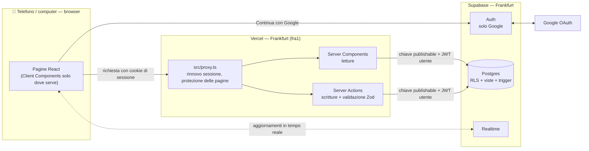

# Nucleo

Le spese di casa, divise in due. Sempre chiaro chi deve cosa.

## Architettura

Nucleo è una web app privata per due persone: registrano le spese comuni, vedono chi ha pagato cosa e sanno in ogni momento chi deve quanto all'altro. Si usa dal browser del telefono e del computer, all'indirizzo `https://dashboard-denel.vercel.app`.

### Scelte principali

- **I permessi e i conti stanno nel database.** La Row Level Security decide chi vede cosa, su ogni tabella. Le viste SQL (`quote_spese`, `saldi`, `spesa_mensile_per_categoria`) calcolano quote, saldo e budget. Tutti i nomi del database sono in italiano, con un commento su ogni tabella e colonna. Un bug nel frontend non può esporre dati né sbagliare un saldo.
- **Importi in centesimi interi**, mai in virgola mobile. Le spese si dividono 50/50 oppure 100/0 ("per l'altra persona"); nelle divisioni dispari il centesimo resta a chi ha pagato.
- **Niente cancellazioni vere** su spese e rimborsi: c'è `data_eliminazione`. Da qui arrivano il Cestino e l'annullamento dei rimborsi. Ogni modifica finisce nella tabella `cronologia`, scritta solo da trigger.
- **Accesso solo con Google.** L'app non invia email. Il partner entra con un link d'invito; prima dell'accesso la pagina mostra chi invita, tramite la funzione `anteprima_invito()`.
- **Web app nel browser**, non installabile: niente funzioni native come widget o notifiche di sistema.
- **Tema chiaro e scuro**, che segue l'impostazione del sistema. I design token stanno in `src/app/globals.css`.
- **Aspetto di iOS 27**: ogni schermata segue i wireframe v2.2 e il design system di iOS 27 (Liquid Glass), adattato al browser: font di sistema, barra in basso in vetro, fogli dal basso, aree di tocco di almeno 44 px.

### Regole di accesso ai dati

1. Letture nei Server Components, con il client Supabase lato server (`@supabase/ssr`).
2. Scritture solo nelle Server Actions, con validazione Zod. La RLS fa comunque da ultima difesa.
3. Il client Supabase nel browser serve solo per il login con Google e per Realtime.
4. La chiave secret si usa in un solo punto, la cancellazione dell'account, e solo lato server.
5. Saldo, quote e budget si leggono dalle viste: non vengono mai ricalcolati in TypeScript.

### Stack

| Livello | Tecnologia |
| --- | --- |
| Linguaggio | TypeScript |
| Interfaccia | React 19, Tailwind CSS v4 |
| Framework | Next.js 16 (App Router, React Compiler) |
| Backend | Supabase: Postgres, Auth, Row Level Security, Realtime |
| Hosting | Vercel |
| Strumenti | pnpm, Vitest, pgTAP, GitHub Actions |

### Controlli

| Comando | Cosa verifica |
| --- | --- |
| `pnpm lint && pnpm typecheck && pnpm test` | Stile, tipi e test unitari (job `check` della CI) |
| `pnpm exec supabase db start && pnpm exec supabase test db` | Schema, RLS e conti con i test pgTAP di `supabase/tests/` (job `db` della CI) |

Entrambi i job sono obbligatori per unire una PR su `main`.

Dati in UE: Supabase e le funzioni Vercel girano a Francoforte.
